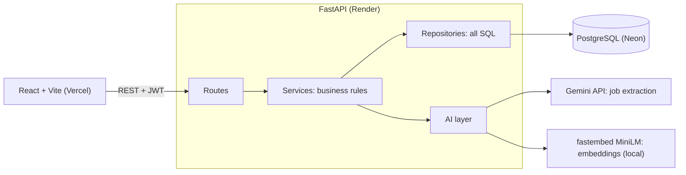
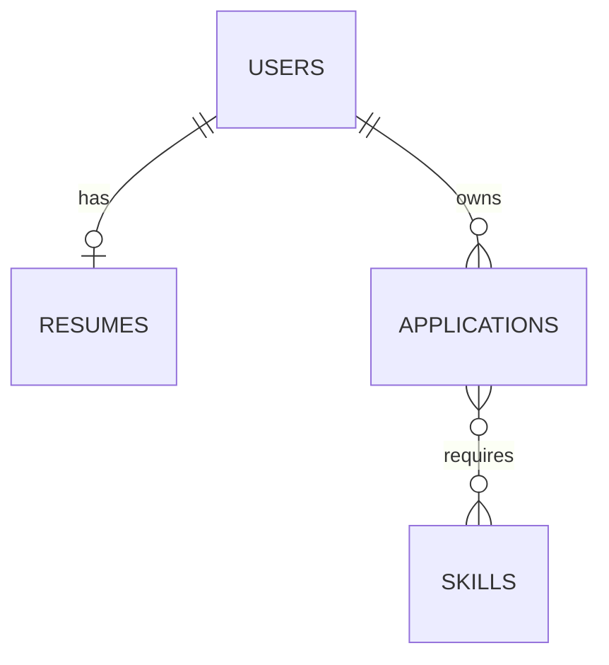

# Job Tracker

A full-stack job application tracker with a Kanban board and AI-assisted match scoring.
Paste a job description and your resume, and the app extracts the required skills with an LLM
and scores how well you match.

## Features
- Register and log in (JWT); every query is scoped to the logged-in user
- Kanban board with drag-and-drop; the backend rejects illegal status moves and the UI rolls back
- Add, edit, delete applications; setting an applied date moves a Saved card to Applied
- Resume storage; AI job analysis: required skills, seniority, keywords, match score,
  and which skills you have or are missing
- Analytics: pipeline counts, applications per week, response rate, most-missing skills

## Architecture



Routes handle HTTP only, services hold business rules and know nothing about HTTP,
and repositories are the only code that touches the database. The AI client is wrapped
in its own module, so the provider can be swapped in one file.

## Data model



`application_skills` is the join table. AI results that are display-only live in a JSON
column on `applications`; skills are a real table because they are queried and shared.

## How the match score works
1. An LLM extracts skills, seniority, and keywords from the job description as JSON,
   which is validated with Pydantic (with one retry on invalid output).
2. Skill coverage = share of required skills found in the resume (normalized, whole-word match).
3. Semantic score = both texts are split into overlapping chunks and embedded; for each job chunk
   the best-matching resume chunk is found with cosine similarity, then averaged and rescaled.
4. `score = 0.6 × semantic + 0.4 × coverage`.

## Design decisions and trade-offs
- **Server owns the state machine.** The UI never copies the transition rules; it applies moves
  optimistically and rolls back on rejection.
- **Postgres in production, SQLite locally**, selected by one `DATABASE_URL` variable.
- **fastembed instead of PyTorch** so the model fits a 512 MB free instance.
- **AI is allowlisted in the public demo** because the free Gemini tier's terms restrict
  serving users in the EU and UK, and resumes contain personal data.
- **Coverage instead of Jaccard** for skills, so long resumes aren't penalized for extra skills.

## Run locally
```bash
# backend
cd backend && python3 -m venv venv && source venv/bin/activate
pip install -r requirements-dev.txt
cp .env.example .env        # fill in values
uvicorn app.main:app --reload

# frontend
cd frontend && npm install && npm run dev
```

| Variable | Purpose |
|---|---|
| `SECRET_KEY` | JWT signing key |
| `DATABASE_URL` | optional; defaults to local SQLite |
| `FRONTEND_ORIGIN` | allowed CORS origin |
| `GEMINI_API_KEY`, `LLM_MODEL` | LLM access |
| `AI_ALLOWED_EMAILS` | who may run AI analysis (`*` = everyone) |

Tests: `cd backend && pytest`

## Known limitations
- No database migrations yet (tables are created on startup)
- Changing your resume does not refresh old match scores
- Free-tier hosting means cold starts

## Tech stack
React, Vite, Recharts, @dnd-kit · FastAPI, SQLAlchemy, Pydantic · PostgreSQL (Neon) ·
Gemini API · fastembed · Vercel, Render
